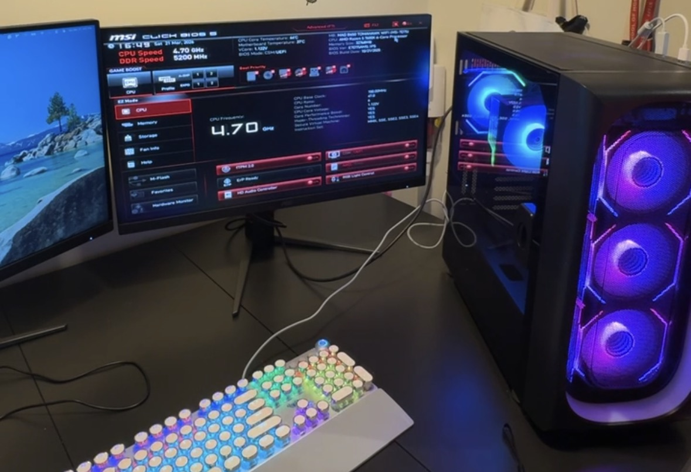

# My First Custom PC Build

A personal project I completed after passing CompTIA A+ (Core 1 and Core 2), built to apply what I learned and to support my cybersecurity studies.

## Goal
Build a PC that can run virtual machines and several programs at once (SIEM tools, a web browser and a local LLM), plus video conferencing and everyday use, while leaving room to upgrade.

## Requirements
- Running virtual machines
- Multitasking across SIEM tools, VMs, a browser and a local LLM
- Webinar and online meeting tools
- An OS compatible with many virtual tools
- Web browsing and video streaming

## Components
| Part | Choice |
|---|---|
| CPU | AMD Ryzen 5 7600X |
| RAM | Crucial Pro DDR5 32GB (2 x 16GB) |
| Storage | Samsung 990 EVO Plus 1TB |
| Motherboard | MSI MAG B650 Tomahawk WiFi |
| Power supply | Corsair RM750e (modular) |
| Case and cooling | Jizhi Ai ARGB Halo ATX case, LovingCool AP-600 heat sink, 7 ARGB fans |
| OS | Windows 11 Pro |

**Why Windows 11 Pro:** It works with many virtual tools, and it is widely used in business environments.

## Key takeaways
- **Read the documentation first:** Manuals prevent mistakes and damage, and the same applies before changing any system.
- **Ask for help when needed:** Getting advice saved me from buying parts I didn't need.
- **Troubleshoot systematically:** I changed one thing at a time, which is the same approach used in security investigations.
- **Plan for now and later:** I balanced performance, cost, compatibility and upgradeability.
- **Configuration is part of security:** Firmware settings, OS installation, updates and account security all affect the finished system.

## Skills demonstrated
Requirements analysis, hardware selection and compatibility, troubleshooting, reading technical documentation, system setup

## Full write-up
[Portfolio page](https://sites.google.com/view/ashantim-cybersec/projects/my-first-custom-pc-build)
